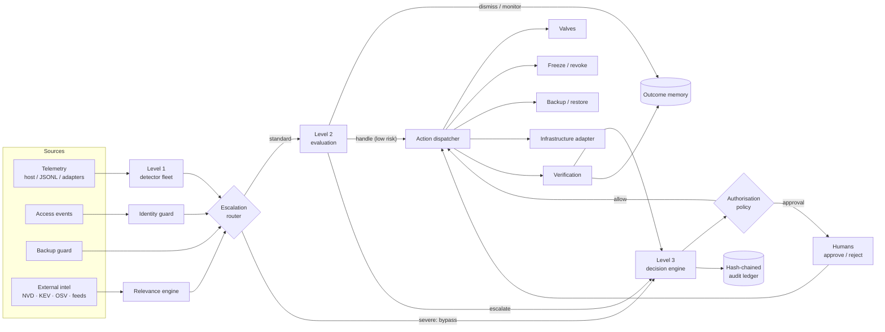

# AIPS: Autonomous Infrastructure Protection System

[](https://github.com/harshithkala2-debug/autonomous-infrastructure-protection-system/actions/workflows/ci.yml)


[](LICENSE)

AIPS is a hierarchical, multi-agent system that **detects, evaluates, decides, repairs, contains and recovers**
problems in an organisation's technology infrastructure: servers, cloud identities, and the **AI agents** that
now act on them. Every change it makes passes through an explicit authorisation policy and is recorded in a
tamper-evident audit ledger.

**New in 1.4: protection for AI agents.** AIPS checks every tool call an AI agent makes (Claude Code, your own
Python agent, or any framework over HTTP). It **blocks** harmful or runaway actions, **asks** a human about
risky ones, **saves** files before they change, **freezes** a misbehaving agent and **reverts** what it did.
Tested live with a real Claude Code agent: AIPS blocked an attempt to send a credential away and froze the
session, caught a prompt injection, and restored a file the agent overwrote.
[docs/AGENTS.md](docs/AGENTS.md) · [live evidence](docs/field-tests/agent-live-2026-11-23.json) · [field test report (PDF)](docs/AIPS_Field_Test_Report.pdf)

```bash
pip install -e .
aips agent demo                                             # a hijacked agent, contained end to end
aips agent install-hook --settings ~/.claude/settings.json  # protect Claude Code
```

It puts the functions below into one coordinated control loop:

| Capability | What AIPS does |
|---|---|
| **Three-level decision hierarchy** | Level 1 detection bots → Level 2 evaluation → Level 3 final decisions, with severity-based bypass straight to Level 3 |
| **Specialised bots** | Health, threshold, anomaly (EWMA), capacity forecast, configuration drift, port exposure, certificate expiry and external-alert detectors |
| **Identity & access protection** | Per-identity permission boundaries, a behavioural profile learned only from legitimate activity, risk scoring, freeze/revoke, and an **appeal workflow** for wrongly restricted users |
| **Adaptive repair** | Records the known-good state, compares the live state against it, applies playbooks, verifies, retries step by step, rolls back on failure and hands off to humans |
| **Two traffic-control valves** | An ingress valve and an internal valve per component. Token-bucket rate limiting and priority shedding while repairing, then AIMD ramp-up once the component is healthy |
| **Layered backup & vault** | Main layer → content-addressed backup copy → write-once vault reachable only from the organisation's own networks. A mass-encryption (ransomware) guard keeps corrupted data out of the vault |
| **External intelligence** | NVD, CISA KEV, OSV and RSS/Atom postmortem feeds. Version-range relevance matching and failure-pattern checks against *your* environment |
| **Safety & governance** | Risk-tiered policy, two-person rule for high-risk actions, kill switch, dry-run mode, rate limits against repair loops, protected targets, HMAC hash-chained audit log |
| **Layer mesh: any layer can call any other** | Layers register capabilities and call each other at runtime. Level 2 asks Level 1 for a fresh re-scan when unsure; Level 3 re-checks with Level 1 before risky or approved actions; fleets escalate straight to Level 3. Loops and runaway call depth are refused. |
| **Persistent experience** | A SQLite history of every episode (strategy, actions, outcome, reward, timing, relapses) and of each detector's accuracy. It survives restarts and drives chronic-issue escalation. |
| **Google Cloud integration** | Discovers a project, then watches Cloud Monitoring, firewall rules, internet exposure, Cloud Audit Logs and Security Command Center. Acts through Compute Engine and IAM: VM reset, MIG restart and resize, deny rules, quarantine, firewall restore, service-account disable. Each action has a rollback, and the whole integration is tested end to end against an API emulator. See [docs/GCP.md](docs/GCP.md). |
| **AI agent protection** | Judges every tool call before it runs: harm rules (wiping data, `curl \| sh`, sending secrets away, disabling security, privilege grabs, tampering with the guard), the agent's policy, and its behaviour (loops, bursts, error storms, prompt-injection taint). Checkpoints files first; Level 3 freezes the agent and reverts its changes through the policy. Works as a Claude Code hook, a Python wrapper and an HTTP API. See [docs/AGENTS.md](docs/AGENTS.md). |
| **Automatic strategy exploration** | Several alternative playbooks per problem. AIPS starts with the reviewed default, tries each alternative once, then uses Thompson sampling to favour what works, and switches strategy when a fix fails or relapses. It never experiments with containment or on critical assets. |

The core has **zero runtime dependencies** (Python ≥ 3.11 standard library only). AES-GCM backup encryption is
optional and uses `cryptography`.

> **Status: v1.4.0.** The complete system is implemented and tested on Linux, Windows and macOS (Python 3.11
> to 3.13): 116 tests, plus all 17 simulator scenarios on 20 random seeds in CI. Field tests so far:
> * **Real Google Cloud project:** a staged service-account misuse was detected from the real audit log and the
>   account disabled in IAM within 31 seconds, with 6 of 6 live safety tests passing. Everything the attacker
>   created (account, key, role grant, including late log events) was reverted.
>   [docs/FIELD_TEST_GCP.md](docs/FIELD_TEST_GCP.md)
> * **Real Claude Code agent:** an exfiltration attempt was blocked and the agent frozen, a prompt injection was
>   flagged and the session tainted, and an overwritten file was restored.
>   [docs/AGENTS.md](docs/AGENTS.md)
> * **A live dry run on a workstation** with live NVD/KEV feeds. [docs/TESTING.md](docs/TESTING.md)
>
> All of this is in the 24-page [field test report](docs/AIPS_Field_Test_Report.pdf). Every claim is linked to raw
> evidence that is quoted in full and SHA-256 fingerprinted.
>
> AIPS has **not been validated on production infrastructure** yet. See [Limitations](#limitations). The original
> concept is in [`autonomous_infrastructure_protection_system_plan.md`](autonomous_infrastructure_protection_system_plan.md).

---

## Quick start

**Step-by-step instructions for Windows, macOS and Linux are in [docs/SETUP.md](docs/SETUP.md).** The short
version:

```bash
git clone https://github.com/harshithkala2-debug/autonomous-infrastructure-protection-system.git
cd autonomous-infrastructure-protection-system
python -m venv .venv && source .venv/bin/activate     # Windows: .venv\Scripts\Activate.ps1
pip install -e ".[dev]"

aips demo                   # 17 end-to-end incident scenarios with success criteria
aips demo --scenario ransomware -v   # full incident timeline
aips agent demo             # an AI agent hijacked by prompt injection, contained and reverted
aips bench --seeds 1-10     # benchmark across random seeds
python -m pytest -q         # the test suite
aips run --config examples/aips-local.toml --no-api --ticks 4 --tick-seconds 5   # watch your own computer (changes nothing)
```

Example (`aips demo --scenario ransomware -v`, abridged):

```
[PASS] ransomware  detect   30s  resolve  240s  incidents  1  actions  4
         ok  mass encryption detected
         ok  vault never received a suspect snapshot  (5 vault snapshots)
         ok  host isolated
         ok  restore required two distinct approvers
         ok  files restored byte-for-byte  (20 files)
         ok  vault refuses callers outside the organisation's network
         ok  audit chain intact
         - INC-000008 files mass_encryption -> resolved [L3_DECISION, ransomware-containment]
             +30s  L3 opened Possible ransomware: 12/20 files modified or removed, mean entropy 7.75 bits/byte
             +30s  L3 action backup.hold_replication on files: ok vault replication held
             +30s  L3 approval_requested APR-000011: host.isolate on files - risk HIGH exceeds autonomy ceiling
             +120s L3 approval_granted APR-000011 by alice-sre, bob-sre
             +120s L3 action host.isolate on files: ok host isolated from network
             +180s L3 action backup.restore on files: ok restored 20 files; verified=True
             +240s L3 resolved signal_clear: signal cleared
```

## Benchmark (simulator, 10 seeds, 30-second control cycle)

`aips bench --seeds 1-10`

| Scenario | Pass | MTTD | MTTR | Actions | False-positive incidents |
|---|---|---|---|---|---|
| service_crash | 100% | ≤1 cycle | 60 s | 3 | 0 |
| crash_loop (must hand to humans) | 100% | ≤1 cycle | n/a, escalated | 5 | 0 |
| dependency_failure (root cause) | 100% | ≤1 cycle | 60 s | 3 | 0 |
| traffic_surge (valves) | 100% | ≤1 cycle | 60 s | 4 | 0 |
| disk_forecast (act before 90 %) | 100% | 93 s | 153 s | 1 | 0 |
| config_drift (TLS disabled) | 100% | ≤1 cycle | 60 s | 1 | 0 |
| exposed_port | 100% | ≤1 cycle | 60 s | 1 | 0 |
| credential_misuse | 100% | ≤1 cycle | 30 s | 3 | 0 |
| false_freeze_appeal | 100% | ≤1 cycle | n/a, appeal | 3 | 0 |
| ransomware | 100% | 30 s | 240 s* | 4 | 0 |
| vulnerability_intel | 100% | ≤1 cycle | 120 s* | 6 | 0 |
| false_alarm (must not act) | 100% | – | – | 0 | 0 |
| kill_switch | 100% | ≤1 cycle | 300 s* | 3 | 0 |
| cert_expiry | 100% | ≤1 cycle | 60 s | 1 | 0 |
| strategy_learning (10 surges, learns best fix) | 100% | ≤1 cycle | 60 s per surge | 30 total | 0 |
| transient_drift (cleared before acting) | 100% | ≤1 cycle | 270 s* | 0 | 0 |
| experience_carryover (new process reuses history) | 100% | ≤1 cycle | 60 s per surge | 10 total | 0 |

\* includes the simulated time humans took to approve. "≤1 cycle" means the fault was detected in the same
30-second cycle in which it was injected. These are **simulator** results. They show the logic is correct
and repeatable, but they say nothing about performance on a real network. See [`docs/TESTING.md`](docs/TESTING.md).

---

## How it works



One **tick** runs the full workflow from concept §8: collect → detect → route → evaluate → decide → act →
verify → ramp valves → learn → audit. Details are in [`docs/ARCHITECTURE.md`](docs/ARCHITECTURE.md). The
complete technical specification, which answers every open item in concept §11, is in
[`docs/SPECIFICATION.md`](docs/SPECIFICATION.md).

### The three levels

* **Level 1** bots only *report*. A finding records the detector, category, severity (raised for business-critical
  assets), confidence, evidence and signal.
* The **escalation router** sends a finding straight to Level 3 when it is CRITICAL, HIGH with ≥ 0.9 confidence,
  or a HIGH security, identity or data-integrity finding. Everything else goes to Level 2.
* **Level 2** groups findings into *cases* and judges them on:
  * corroboration by independent detectors
  * persistence and flapping
  * the dependency graph (is this a symptom of an upstream failure?)
  * maintenance windows and operator suppressions
  * the detector's historical precision

  It then **dismisses** the case, **monitors** it, **handles** it with a low-risk Level 2 playbook, or
  **escalates** it.
* **Level 3** opens incidents and selects a playbook. It correlates symptoms on the same asset, holds dependents
  as symptoms of a root cause and resolves conflicts between incidents by priority
  (containment > integrity > availability > performance). It then acts, verifies, retries, escalates to humans,
  or rolls back.

### Safety model

Every action goes through `AuthorizationPolicy`:

* **DENY**: the action kind is unknown, or the requester is below the minimum level (Level 2 cannot isolate a host).
* **REQUIRE_APPROVAL**:
  * the risk is above the autonomy ceiling
  * the action kind always needs approval (`backup.restore`, `package.upgrade`)
  * the target is protected (`break-glass-*`)
  * the asset is business-critical and the risk is MEDIUM or higher
  * the per-target rate limit is hit (repair-loop protection) or the global action budget is used up
  * the kill switch is engaged

  HIGH-risk approvals need **two different people**.
* **ALLOW**: everything else, recorded with full rationale.

Dry-run mode runs every decision but executes nothing. Containment actions are never rolled back automatically.

---

## Running against real infrastructure

```bash
export AIPS_API_TOKEN=$(python -c "import secrets;print(secrets.token_hex(24))")
export AIPS_AUDIT_KEY=$(python -c "import secrets;print(secrets.token_hex(32))")
export AIPS_BACKUP_HMAC=$(python -c "import secrets;print(secrets.token_hex(32))")
aips run --config examples/aips.toml        # starts in dry_run = true
```

* **Inventory**: [`examples/inventory.toml`](examples/inventory.toml) lists assets, dependencies, criticality,
  software versions, allowed ports and certificates.
* **Telemetry**: the built-in host source covers disk, load, TCP/HTTP probes and config-file fingerprints. A JSONL
  source lets any existing agent (a Prometheus bridge, Fluent Bit, scripts) feed observations.
* **Adapters**: `CommandAdapter` runs allow-listed command templates (`systemctl`, `kubectl`, `terraform`, cloud
  CLIs). It runs them without a shell, rejects injected arguments and supports rollback templates. Write your own
  by implementing `InfrastructureAdapter.execute/rollback/health`.
* **API**: REST control plane on `127.0.0.1:8780` for incidents, approvals, appeals, kill switch, access-event
  ingestion, baselines, audit verification and Prometheus `/metrics`. See
  [`docs/OPERATIONS.md`](docs/OPERATIONS.md).
* **Intel**: `aips intel assess --config examples/aips.toml` (add `--offline` to use the bundled fixtures).
* **Backups**: `aips backup snapshot|replicate|verify|drill|restore|prune|status --config ...`
* **Audit**: `aips audit verify runtime/aips-data/audit.jsonl --key-env AIPS_AUDIT_KEY`
* **Docker**: `docker build -t aips . && docker run -v $PWD/examples:/config -e AIPS_API_TOKEN=... aips`

> Test against systems you own or are explicitly authorised to test. Start in `dry_run`, review the audit log,
> then widen autonomy one action class at a time.

---

## Repository layout

```
aips/
  core/         models, event bus, layer mesh, audit ledger, authorisation policy, clocks
  telemetry/    inventory, telemetry sources
  monitoring/   Level 1 detector fleet
  evaluation/   escalation router, Level 2 evaluator, outcome memory
  decision/     playbooks + variants, strategy selector, Level 3 decision engine, verification
  experience/   persistent SQLite experience store
  repair/       known-good baselines, drift diff, action dispatcher, adapters
  traffic/      the two valves and their controller
  identity/     permission boundaries, behaviour profiles, freeze, appeals
  agents/       AI agent guard: harm rules, checkpoints, freeze, revert, Claude Code hook, demo
  backup/       object store, signed manifests, vault, backup manager
  intel/        collectors (NVD/KEV/OSV/feeds), version ranges, relevance, failure patterns
  sim/          simulator, fault injection, scenarios, benchmark
  api/          HTTP control plane
  integrations/gcp/  Google Cloud: auth, client, discovery, telemetry, actions, API emulator
  orchestrator.py  wiring + control loop
  config.py        TOML -> running system
  cli.py           `aips` command
docs/           setup, AI agents, architecture, specification, threat model, operations, testing, GCP
examples/       configuration + inventory
tests/          unit, integration, scenario and API tests
```

## Limitations

These are stated plainly so that engineers can evaluate the system fairly:

* **Evaluation is mostly simulation-based.** The simulator models real failure dynamics (saturation, cascading
  dependency errors, disk growth) and corrupts real files on disk for the ransomware scenario. It is still a model.
  One live dry run on a single workstation with live NVD/KEV feeds found real issues and a real bug, now fixed
  (see [`docs/TESTING.md`](docs/TESTING.md#field-test-live-dry-run-on-a-real-workstation)). AIPS has not been
  run on production servers or compared head-to-head with commercial tools.
* **Adapters are the integration boundary.** Native adapters exist for Google Cloud (REST, no SDK) and for the
  simulator, plus a generic command adapter and a recording adapter. AWS, Azure and Kubernetes are configured
  through command templates for now; native adapters for them are future work.
* **The AI agent guard is a gate, not a sandbox.** It sees the calls that pass through it. An agent that
  deliberately disguises a command can get past text rules. Behaviour checks, checkpoints, taint and freezing
  limit the damage, but run agents you don't trust in a container or VM as well. See
  [docs/AGENTS.md](docs/AGENTS.md#limits-read-these).
* **Detection is statistical and rule-based.** There are no trained ML models. The anomaly detector is EWMA/z-score
  with level-shift handling. That choice keeps the system explainable, but subtle attacks may be missed.
* **Single process.** The bus is in-process and synchronous for determinism. A distributed deployment would need
  a durable transport (Kafka/NATS) behind the same interface.
* **Intel fixtures are synthetic.** Bundled advisories use fictional `CVE-2099-*` IDs and products. Live collectors
  call the real NVD, CISA KEV and OSV APIs.

See [`docs/ROADMAP.md`](docs/ROADMAP.md).

## Contributing

Issues and pull requests are welcome: detectors, platform adapters (AWS, Azure, Kubernetes), agent integrations
(LangChain, Cursor, MCP gateways) and docs. See [CONTRIBUTING.md](CONTRIBUTING.md). Report security issues
privately: [SECURITY.md](SECURITY.md).

## License

[MIT](LICENSE) © 2026 harshithkala2-debug.
